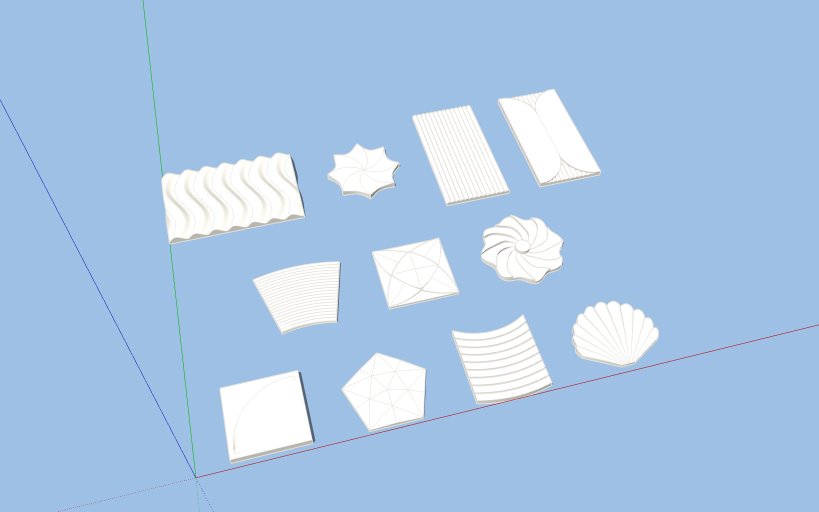

# Thư viện gạch 3D ốp tường (UHPC)

`Thu_vien_gach_3D_UHPC.skp`: 11 component dựng theo ảnh mẫu. Định dạng SketchUp 2017, mở được trên mọi bản từ 2017 trở lên.

| Component | Kích thước (mm) | Dày (mm) |
|---|---|---|
| `G3D_01_Song_Luon_600x400` | 600 × 400 | 12–40 |
| `G3D_02_Sao_Xoay_D340` | Ø340 | 18–30 |
| `G3D_03_Soc_Tron_300x600` | 300 × 600 | 14–22 |
| `G3D_04_Soc_No_300x600` | 300 × 600 | 14–30 |
| `G3D_05_Gan_Cong_R450-750` | quạt R450–R750 (371 × 314) | 15–20 |
| `G3D_06_Mat_La_Hinh_Hoc_300x300` | 300 × 300 | 12–34 |
| `G3D_07_Hoa_Xoay_D360` | Ø368 | 17–42 |
| `G3D_08_La_Cong_300x300` | 300 × 300 | 30 (lõm ~16) |
| `G3D_09_Da_Giac_Khoi_R175` | ngũ giác 333 × 317 | 12–40 |
| `G3D_10_Vong_Cung_300` | 300 × 344 | 20–26 |
| `G3D_11_Vo_So_350` | 349 × 291 | 14–29 |

- Mỗi mẫu là một khối solid kín (Solid Tools, xuất STL/CNC dùng được).
- Mặt sau nằm ở Z = 0, điểm chèn là góc trái-dưới của khung bao.
- Đã bật **Glue to: Any**: kéo từ bảng Components thả lên mặt tường thì gạch tự áp vào mặt đó, phần nổi hướng ra ngoài.
- Vật liệu `UHPC_Trang` gán lên các mặt; đổi màu trong Materials > In Model.
- Đem vào dự án: File > Import file này, đặt xuống, Explode một lần. Cả 11 mẫu sẽ hiện trong Components > In Model.
